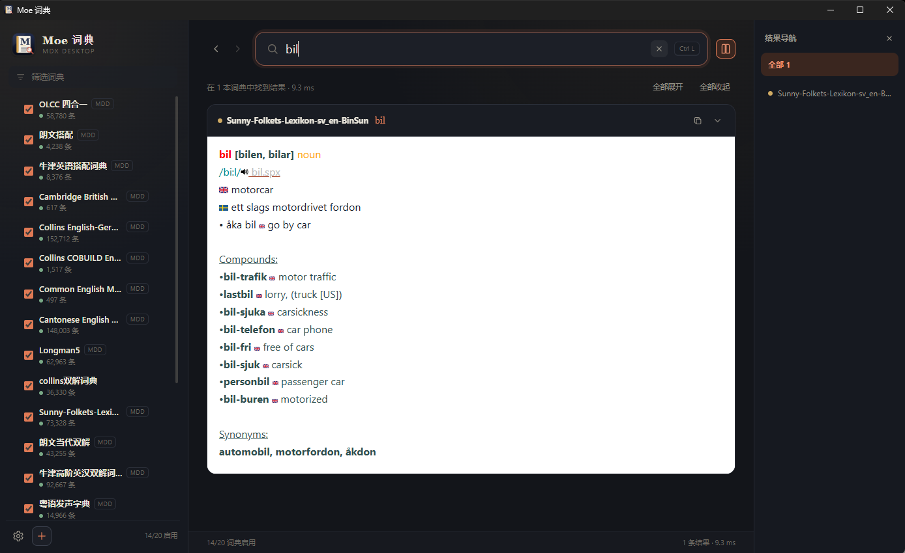

# MoeDict

轻量级、跨平台的 MDX 桌面词典：**Tauri 2 外壳 + 原生 Rust 核心 + 无构建步骤的 WebView 界面**。



## 特性

- **词典路径管理**：添加 `.mdx` 文件或递归扫描文件夹，支持拖拽文件/文件夹到窗口；移除词典不会删除磁盘文件。
- **排序与筛选**：拖拽或菜单上移/下移调整词典顺序；侧栏可实时筛选词典；每本词典可独立启用/停用。
- **查询结果**：按你的词典顺序同时展示所有命中词典（不是只返回第一本）；释义在独立沙箱 iframe 中渲染，词典自带的 CSS 互不污染。
- **输入联想**：前缀联想、跨词典合并、键盘上下选择、回车查询；"试试手气"随机抽词。
- **索引进度**：后台单线程索引，侧栏/状态栏显示进度，可取消、可重建；源文件变化会被识别为"待重建"。
- **MDD 资源**：释义中的图片、字体、CSS、发音从同名 `.mdd` 中按需读取；支持拆分 MDD（`.1.mdd` 等）。
- **内存友好**：MDX 使用 mmap，不整文件读入；释义按 zstd 压缩存储；索引按需 mmap，无 SQLite/WAL/缓存池；空闲时内存主要是 WebView 本身。
- **安全**：词典脚本被移除、iframe 不启用脚本、CSP 限制远程资源；资源协议限制在词典目录/MDD 内，外部链接只允许 http/https/mailto。

## 架构

```
crates/mdict-core/     与 UI 无关的核心库
  mdict/               MDX/MDD 解析（mmap、按 record block 解压）
  index/               自定义只读索引（排序键 + zstd 释义）
  registry.rs          词典配置、索引任务、查询/联想/资源读取
  mdd.rs               MDD 资源随机访问
src-tauri/             Tauri 2 桌面外壳
  src/commands.rs      IPC 命令
  src/indexer.rs       单线程索引工作线程 + 进度事件
  src/protocol.rs      mdict:// 资源协议
ui/                    无框架前端（HTML/CSS/vanilla JS）
```

### 为什么不用 SQLite / Turso

词典数据是**只读、不可变**的，查询是**单键点查 + 前缀扫描**：

- 通用数据库的并发写/事务能力用不上；SQLite 调好缓存也很轻，但仍然是多一层引擎。
- Turso 0.8 的优势集中在并发写（`BEGIN CONCURRENT`/MVCC），仍是 0.8 预发布，FTS 是实验性的 Tantivy 后端而非 FTS5。
- 自定义 `.idx` 只需 mmap + 二分查找 + zstd，启动零开销，无 WAL、无连接池、无后台线程。

索引文件格式（`index/format.rs`）：128 字节头 + 固定 32 字节记录 + 键字符串池 + zstd 释义块；写入临时文件后原子替换。

## 示例词典与数据来源

仓库内置一份开源示例词典 `resources/mdx/folkets_sv_en.mdx`（瑞典语 → 英语）：

- 数据来自 KTH 的 [Folkets lexikon](http://folkets-lexikon.csc.kth.se/folkets/om.en.html)，内容采用 [CC BY-SA 2.5](https://creativecommons.org/licenses/by-sa/2.5/) 许可；本项目仅将其公开 XDXF 数据转换为 MDX 格式。
- 同一数据集的 MDict 版本见 [SunnyBingoMe/Sunny-Folkets-Lexikon](https://github.com/SunnyBingoMe/Sunny-Folkets-Lexikon)（作者 BinSun）。
- 仅提交 `.mdx`；约 858 MB 的配套音频 `.mdd` 不随仓库提交，因此发音功能需要自备该文件。
- 其他词典数据一律不纳入版本控制，详见 [`resources/mdx/README.md`](resources/mdx/README.md)。

## 音标字体（可选）

部分词典（如金山词霸系词典）使用 `Kingsoft Phonetic Plain` / `Kingsoft Phonetic` 字体显示音标。该字体是金山公司的专有字体，**仓库不再附带**，此前版本中的 `ui/fonts/KingsoftPhoneticPlain.ttf` 已移除，以避免再分发许可问题。

- **影响**：缺少该字体时，音标会回退到系统字体；大多数符号仍可显示，但个别国际音标字符可能字形不正确或缺失。
- **获取方式**：从你已合法安装的 Kingsoft Phonetic（金山音标）或金山词霸安装目录中复制字体文件（常见文件名为 `Kingsoft Phonetic Plain.ttf` 或 `KSPhonetic*.ttf`，不同版本可能不同）。
- **使用方式**：

  1. 将字体文件复制到 `ui/fonts/`，并命名为 `KingsoftPhoneticPlain.ttf`（目录不存在则自行创建）。
  2. 重新构建并运行：

  ```bash
  cargo run -p moedict
  ```

  界面静态资源在编译时嵌入二进制，仅放入文件而不重新编译不会生效。
- 该目录已被 `.gitignore` 忽略，字体文件不会被误提交；请勿将其推送到公开仓库。

## 开发环境

### Linux（Ubuntu/Debian 22.04+）

```bash
sudo apt update
sudo apt install -y build-essential pkg-config \
  libwebkit2gtk-4.1-dev libgtk-3-dev librsvg2-dev patchelf
# 中文释义/界面需要 CJK 字体
sudo apt install -y fonts-noto-cjk
```

Fedora：`webkit2gtk4.1-devel gtk3-devel librsvg2-devel patchelf`；Arch：`webkit2gtk-4.1 gtk3 librsvg patchelf`。

### Windows

- 安装 Rust（MSVC toolchain）与 Visual Studio Build Tools（C++ 桌面开发）。
- WebView2 Runtime：Windows 10/11 通常已内置；否则安装 Evergreen Runtime。

### macOS

```bash
xcode-select --install
```

## 运行

```bash
# 第一次会提示在界面里添加词典
cargo run -p moedict

# 开发便利：启动时自动添加一个目录（可重复传入多个 --mdx-dir）
cargo run -p moedict -- --mdx-dir ./resources/mdx

# 或使用环境变量
MOEDICT_MDX_DIR=./resources/mdx cargo run -p moedict
```

前端没有 npm/Vite 步骤：`ui/` 下的静态文件在编译时嵌入二进制。修改 `ui/` 后重新 `cargo run` 即可。

## 打包

```bash
cargo install tauri-cli --version "^2" --locked
cargo tauri build
# 产物：target/release/bundle/
```

Linux 上生成 `.deb`/`.rpm`/AppImage；Windows 生成 NSIS/MSI；macOS 生成 `.app`/`.dmg`（需在 macOS 上构建）。
AppImage 运行可能需要 `libfuse2`。

## 数据位置

设置面板会显示实际路径：

- 配置：`<app_config_dir>/config.json`
- 索引：`<app_data_dir>/index/*.idx`
- 日志：`<app_log_dir>/moedict.log`

Linux 通常为 `~/.config/moe.mdict/`、`~/.local/share/moe.mdict/`、`~/.local/share/moe.mdict/logs/`。

源 `.mdx`/`.mdd` 文件只读，不会被修改；索引缓存在应用数据目录，删除后会自动重建。

## 测试与诊断

```bash
cargo test -p mdict-core

# 解析一个真实 MDX/MDD，打印词条数、首尾键和耗时
cargo run --release -p mdict-core --example inspect -- path/to/file.mdx

# 完整链路：添加 → 建索引 → 查询 → 联想 → 读取 MDD 资源 → 重新加载
cargo run --release -p mdict-core --example e2e -- path/to/file.mdx throw
```

`tests/e2e.rs` 会在 `resources/mdx/` 中存在示例词典时自动运行，否则跳过。

## 已知限制

- 主要支持 MDX 2.x；v1 为尽力而为。
- 词典内的 JavaScript 被禁用（安全考虑），依赖脚本的交互/特效不会生效。
- 远程图片/CSS 被 CSP 阻止；资源只从词典目录或 MDD 读取。
- 暂无全文检索与拼写纠错；联想为前缀匹配。
- Speex（`.spx`）发音在某些 WebView 中无法解码；WAV/MP3/OGG 正常。
- 超长释义默认折叠，显示"展开全文"。
- Linux 未安装 CJK 字体时中文会显示为方块。

## 参考

MDX/MDD 格式参考 [mdict-analysis](https://bitbucket.org/xwang/mdict-analysis/src/master/) 与
[MDX/MDD 文件格式解析](http://einverne.github.io/post/2018/08/mdx-mdd-file-format.html)。

## 许可证

本项目代码采用 MIT 或 Apache-2.0 双许可，见 [`LICENSE-MIT`](LICENSE-MIT) 与 [`LICENSE-APACHE`](LICENSE-APACHE)。

`resources/mdx/` 下的示例词典内容按 CC BY-SA 2.5 授权，不适用上述代码许可。
